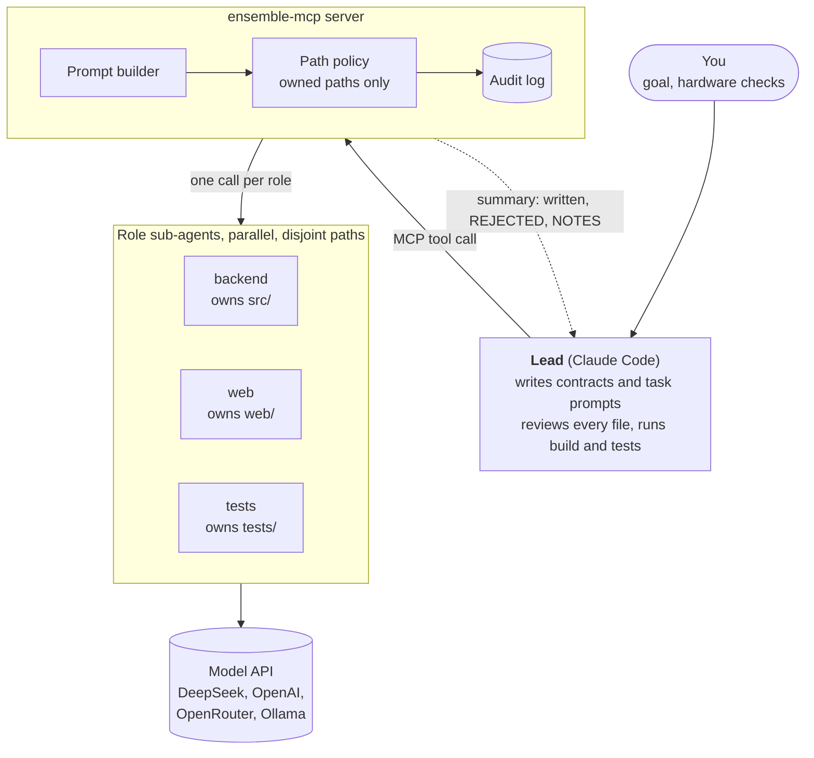
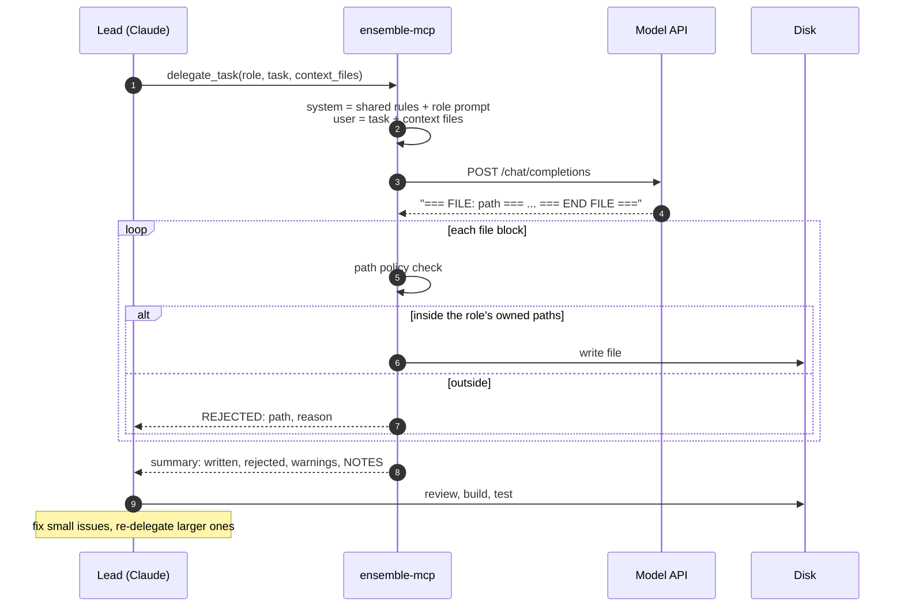
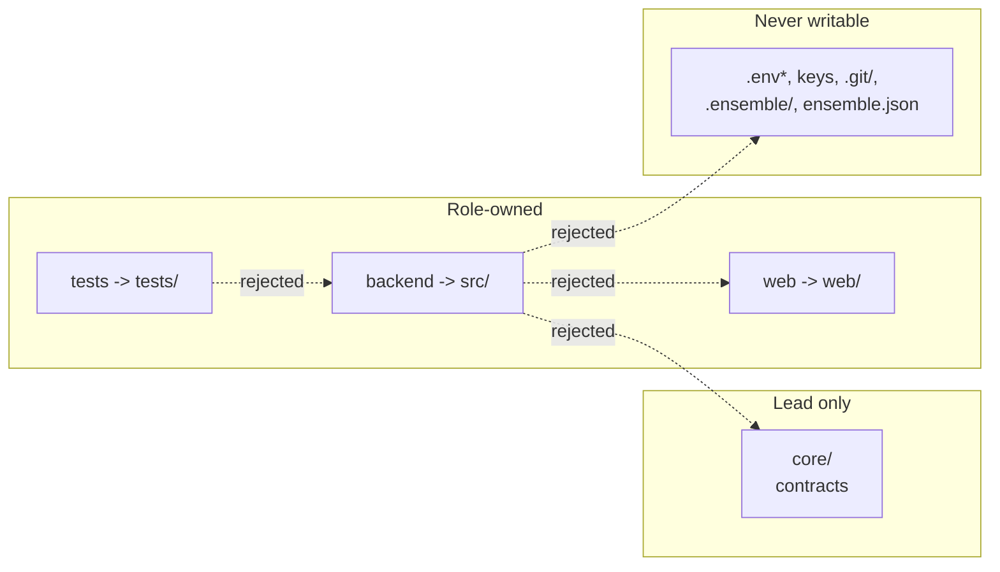
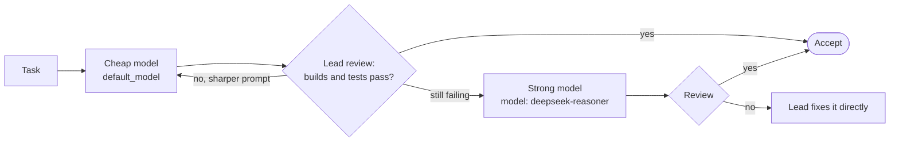
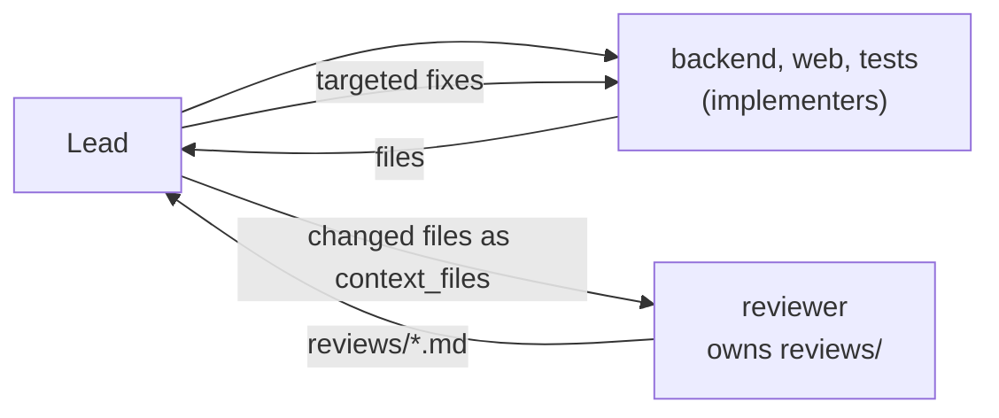
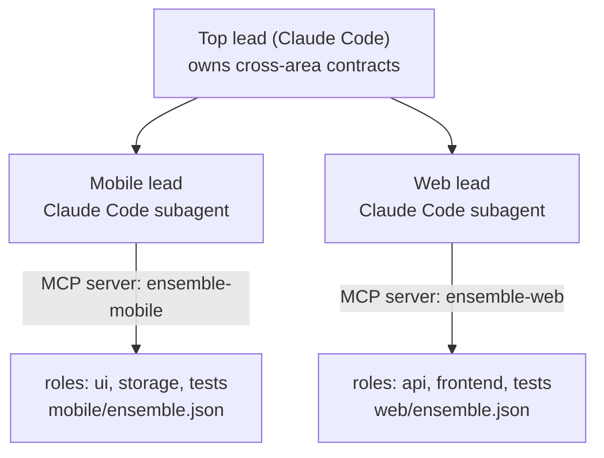
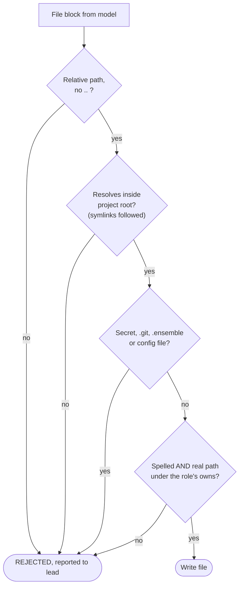

# ensemble-mcp

Let one strong AI **lead** (Claude Code) plan the work and hand the typing to cheaper, **role-scoped sub-agents** (DeepSeek by default, any OpenAI-compatible model works) over [MCP](https://modelcontextprotocol.io). Each sub-agent can only write inside the paths its role owns, so five of them can work in parallel without stepping on each other.

- **Zero dependencies.** One small Python package, stdlib only (Python 3.9+).
- **Enforced ownership.** Writes outside a role's paths are rejected, symlinks included. Secrets and `.git` are never touched.
- **Provider-agnostic.** DeepSeek, OpenAI, OpenRouter, Ollama, anything that speaks `/chat/completions`.
- **Config, not code.** Roles, prompts, shared rules and models live in one `ensemble.json`.
- **Battle-tested workflow.** Built for and used on a real multi-role Swift app. See [examples/swift-ios](examples/swift-ios).

## How it works



The lead owns the **contracts** (shared interfaces and types that no role may write) and is the only reviewer. Sub-agents never see each other's work except through files the lead passes as context. Full design in [docs/ARCHITECTURE.md](docs/ARCHITECTURE.md).

### One delegation, step by step



### Who may write where



## Quick start

```bash
pip install git+https://github.com/VeeraPD/ensemble-mcp      # or: pip install -e . from a clone
cd your-project
ensemble-mcp init                                          # writes ensemble.json + docs/CONVENTIONS.md
export DEEPSEEK_API_KEY=sk-...                             # or put it in ./.env (git-ignored!)
ensemble-mcp check                                         # validates config, key, prompts
```

Register it with Claude Code. Either run

```bash
claude mcp add ensemble -- ensemble-mcp --config /absolute/path/to/your-project/ensemble.json serve
```

or put this in the project's `.mcp.json`:

```json
{
  "mcpServers": {
    "ensemble": {
      "command": "ensemble-mcp",
      "args": ["--config", "/absolute/path/to/your-project/ensemble.json", "serve"]
    }
  }
}
```

Without installing, `"command": "python3", "args": ["-m", "ensemble_mcp", "--config", "...", "serve"]` with `PYTHONPATH=/path/to/ensemble-mcp/src` also works.

Then copy [templates/CLAUDE.md](templates/CLAUDE.md) into your project so the lead knows the workflow, and ask Claude to build something.

## Multi-level agent architectures

Out of the box the server gives you **two levels**: a lead that delegates, and role sub-agents that implement. Because delegation is just an MCP tool plus a config file, you can stack more levels without changing the code. Three patterns, from simple to ambitious. (Patterns 2 and 3 compose existing pieces and have not been battle-tested; start with 1.)

### 1. Model tiers: cheap first, strong on failure

Put a cheap and a strong model in `provider.models`. The lead always starts on the default and only escalates a step that failed.



No extra setup: pass `"model": "<strong model>"` on the retry.

### 2. Implementers and a reviewer

Add a read-mostly **reviewer** role that can only write review notes. The lead passes it the files to inspect and reads its findings instead of reading every line itself. This adds a second sub-agent level (build, then audit) while the lead stays the final judge.



```json
"reviewer": {
  "owns": ["reviews/"],
  "instructions": "Review the files in the context. Write findings to reviews/<topic>.md: bugs, contract violations, missing tests. Do not propose rewrites of whole files.",
  "description": "audits implementer output"
}
```

Use a different (ideally stronger) `model` for the reviewer than the implementers, so it does not repeat their blind spots. The reviewer is advisory: treat its findings like any NOTES, verify before acting.

### 3. Domain leads: one lead per area, one level above them

For a large codebase, give each area its own `ensemble.json` and its own MCP server, and let a Claude Code **subagent** act as the lead of that area, with a top-level lead coordinating the areas.



```bash
claude mcp add ensemble-mobile -- ensemble-mcp -c /abs/path/mobile/ensemble.json serve
claude mcp add ensemble-web    -- ensemble-mcp -c /abs/path/web/ensemble.json serve
```

Rules that keep this sane:
- Cross-area contracts (API schemas, shared types) live in a directory only the **top** lead writes. Area leads and roles treat it as read-only.
- Area `owns` paths must not overlap across configs; the servers do not coordinate with each other.
- Each area lead reports a short summary upward (what changed, what it verified, open questions). The top lead should not re-read every file.
- Add levels only when one lead's context can no longer hold the area. Every level adds latency, cost and a place for misunderstandings; many projects are best served by pattern 1 alone.

## Configuration

`ensemble.json` (paths are relative to this file):

```json
{
  "provider": {
    "base_url": "https://api.deepseek.com",
    "api_key_env": "DEEPSEEK_API_KEY",
    "models": ["deepseek-chat", "deepseek-reasoner"],
    "default_model": "deepseek-chat",
    "timeout": 900,
    "max_retries": 3,
    "max_tokens": 0
  },
  "shared_context": ["docs/CONVENTIONS.md"],
  "max_context_bytes": 120000,
  "max_parallel": 5,
  "audit_log": true,
  "roles": {
    "backend": {
      "owns": ["src/"],
      "instructions_file": "docs/agents/backend.md",
      "context": [],
      "description": "server code"
    }
  }
}
```

| Key | Meaning |
|---|---|
| `provider.base_url` | Any OpenAI-compatible base URL (`/chat/completions` is appended). Ollama: `http://localhost:11434/v1` with `"api_key_env": ""`. |
| `provider.models` / `default_model` | Allowed model names. The lead uses the default and escalates to a stronger one only after failures. Check your provider for current names. |
| `shared_context` | Files prepended to every role's system prompt (coding rules, product brief). |
| `roles.<name>.owns` | Files or directories the role may write. Everything else is rejected. |
| `roles.<name>.instructions_file` / `instructions` | Role prompt, from a file and/or inline. |
| `roles.<name>.context` | Extra files always added to this role's system prompt. |
| `max_parallel` | Cap for `delegate_parallel` (1–16). |
| `audit_log` | Append every run to `.ensemble/log.jsonl`. |

Config is found via `--config`, `$ENSEMBLE_CONFIG`, or by searching upward from the current directory.

## MCP tools

| Tool | Purpose |
|---|---|
| `delegate_task` | One role, one task. Args: `role`, `task`, `context_files`, `model`, `dry_run`. |
| `delegate_parallel` | Up to `max_parallel` tasks with **distinct** roles, run concurrently. One failure does not sink the others. |
| `list_roles` | Roles, owned paths and models. |

Each call returns a summary: files written, files **REJECTED** (outside ownership), a truncation warning if the model hit its token limit, and the sub-agent's `NOTES:` (questions or contract problems it hit). Treat NOTES as claims to verify, not facts.

## CLI

```
ensemble-mcp init [dir]                  scaffold ensemble.json
ensemble-mcp check                       validate setup
ensemble-mcp run ROLE "task" -f file     one task without MCP (add --dry-run to preview)
ensemble-mcp serve                       MCP server on stdio (the default)
```

## Safety

Sub-agent output is untrusted text written to your disk. Every file block goes through this gate:



Ownership, symlink resolution, protected secrets and no code execution limit the blast radius; they do not replace review. Use git and read every diff. Details and what is *not* covered in [SECURITY.md](SECURITY.md). Everything you pass as context is sent to your model provider.

## More docs

- [docs/ARCHITECTURE.md](docs/ARCHITECTURE.md) — layers, prompt assembly, path policy, protocol
- [docs/WRITING_TASKS.md](docs/WRITING_TASKS.md) — how to write prompts that sub-agents get right the first time
- [templates/CLAUDE.md](templates/CLAUDE.md) — drop-in lead workflow for your project
- [examples/](examples) — Swift/iPadOS and Python configs

## Development

```bash
PYTHONPATH=src python3 -m unittest discover -s tests
```

## License

[MIT](LICENSE). Not affiliated with Anthropic or DeepSeek.
